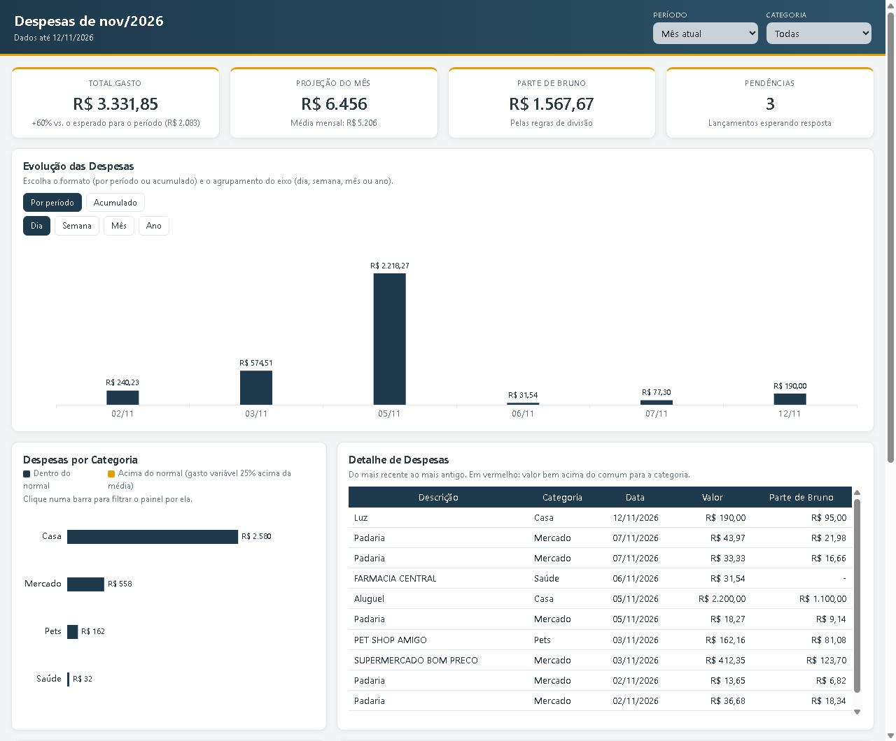

# conciliador-despesas

Conciliador de despesas pessoais pra rodar com o seu próprio LLM. Ele junta o extrato e a fatura, classifica cada lançamento pelas suas regras, divide as despesas com quem mora com você (se dividir) e mostra tudo num painel que abre no navegador.

Comecei isso pra organizar as contas de casa, que eu dividia por categoria numa planilha à mão. Hoje um agente roda todo dia de manhã, me pergunta só o que ele não sabe classificar e me manda um resumo duas vezes por semana. Esta é a versão aberta, sem nada meu, pra quem quiser usar do mesmo jeito.



## O que ele faz

- Lê extrato e fatura em OFX ou CSV de qualquer banco, ou as transações que o agente busca pela Belvo (Open Finance).
- Classifica pelas regras do `regras.yaml`. O que não tem regra vira pergunta, e a sua resposta vira regra pra próxima vez.
- Divide cada despesa entre as pessoas do jeito que vocês combinarem: tudo de um só, por categoria (ex.: casa meio a meio, mercado 70/30), igual entre todos, por estabelecimento ou marcando num lançamento específico. Também mostra quem deve quanto a quem.
- Avisa conta vencida, conta pra vencer e conta paga duas vezes.
- Gera o painel HTML (período, categoria, evolução por dia, semana, mês ou ano, categorias acima do normal, detalhe e itens das compras de mercado) e uma planilha Excel.
- Monta o rascunho do report com os números do mês, pra o agente mandar na frequência que você escolher.

A conta fica com os scripts em Python. O LLM busca os dados, pergunta e escreve. Por isso dá pra usar com o Claude, o Codex, o Gemini ou outro que leia o `AGENTS.md`.

## Começar

Precisa de Python 3.10 ou mais novo.

```
git clone <endereço do repositório>
cd conciliador-despesas
python -m venv .venv
.venv/Scripts/python -m pip install -e ".[dev]"      (no Linux e no Mac: .venv/bin/python)
```

Pra ver funcionando com dados fictícios:

```
cp -r config/exemplo demo                         (no Windows: xcopy config\exemplo demo\ /E)
python exemplos/gerar_demo.py
python -m despesas --pasta demo importar exemplos/demo_belvo.json
python -m despesas --pasta demo painel
```

Depois abra `demo/painel.html` no navegador.

Pra usar com os seus dados, abra o seu agente na pasta do repositório e peça: "siga o `prompts/configurar.md`". Ele pergunta quem divide o quê, de onde vêm os dados e quais são as contas fixas, e cria a pasta `meus-dados/`.

## Comandos

| Comando | O que faz |
|---|---|
| `python -m despesas importar <arquivo>` | Importa OFX, CSV (com `--perfil`) ou o JSON da Belvo, sem duplicar |
| `python -m despesas reaplicar` | Reclassifica as pendências depois de você responder |
| `python -m despesas resumo --mes AAAA-MM` | Total por categoria e por pessoa |
| `python -m despesas acerto` | Quem deve quanto a quem |
| `python -m despesas alertas` | Contas vencidas, a vencer e pagas em dobro |
| `python -m despesas report` | Rascunho do report do mês |
| `python -m despesas painel` | Gera `meus-dados/painel.html` |
| `python -m despesas planilha` | Gera `meus-dados/despesas.xlsx` |

## Privacidade

Os seus dados ficam na pasta `meus-dados/`, no seu computador, e essa pasta não vai pro git. Nada passa por mim nem por servidor nenhum deste projeto. Se você usar a Belvo, quem lê as suas contas é o seu agente, com a sua autorização no Open Finance. O painel não carrega nada da internet.

Antes de cada commit, o `scripts/verificar_dados_pessoais.py` procura CPF, cartão, e-mail e caminho de usuário, além das palavras que você colocar no `.dados_pessoais.txt` (arquivo local). Pra ativar: `git config core.hooksPath .githooks`.

## Aviso

Isto organiza e mostra as suas despesas. Não é aconselhamento financeiro e não recomenda investimento, crédito ou produto nenhum.

## Licença

AGPL-3.0. Você pode usar, mudar e distribuir. Se oferecer uma versão modificada como serviço pela internet, precisa abrir o código dela também.

Feito por Guilherme Moura · Dados & Indicadores.
